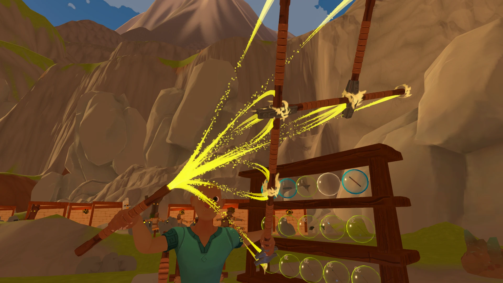

# Blue's In-Game String Tool

A MelonLoader mod for A Township Tale. Build "string" items by hand in the game: pieces in slots the game normally refuses,
handles on handles, guards on guards, backpacks on weapons. No outside string tool, no spawn command.

## Modes

The server owner picks one for everyone and one for admins. Players only install the file.

| Mode | What players can do |
|---|---|
| `Free` (admins by default) | Any piece in any slot, several at the same spot. Anything with slots (handles, backpacks, bows, shield handles) plugs into anything else. |
| `OpenSlots` (everyone by default) | Only the pieces a slot is meant for, one per spot, but every spot at once: side pieces on both ends of a straight handle, big guards on both ends of a short handle. |
| `Off` | The normal game. |

## How to build

- **A piece onto a slot:** hold what you are building in one hand and the piece in the other, bring the piece to a glowing slot, let go.
- **One slotted thing into another (Free):** hold one in each hand. The bare one (nothing on it yet) plugs in by a fixed spot: a handle by one end, a backpack by its buckle. Let go of either hand.
- **Backpacks and pouches** also work on the bag machine.

Two finished builds held together never fuse. There is no way to take things apart again.

## Install

1. Put `BluesInGameStringTool.dll` in the server's `Mods` folder and in every player's `Mods` folder.
2. Start the server once. It writes `UserData\BluesInGameStringTool.cfg`.
3. Edit that file:

| Setting | Default | |
|---|---|---|
| `Mode` | `"OpenSlots"` | Everyone's mode. Restart to change. |
| `AdminMode` | `"Free"` | The mode of the players in `Admins`. Restart to change. |
| `Admins` | `""` | Player names, comma separated, any capitals, e.g. `"Blue_XD, Friend"`. Takes effect within a few seconds, no restart. |

## Good to know

| | |
|---|---|
| Who decides | The server checks every attach. A player's game only decides which slots glow. |
| Players without the mod | Can join and play. They cannot build new combinations but see most of them; a slotted thing plugged into another and a second big guard on a short handle look loose to them. |
| Saving | Built items save like any crafted item and survive a mode change. With the mod removed from the server, slotted things plugged into each other come apart on load. |
| Looks | In Free a piece in a slot not made for it sits however that slot points, and pieces can overlap. |
| Server log | One line per attach request. |
